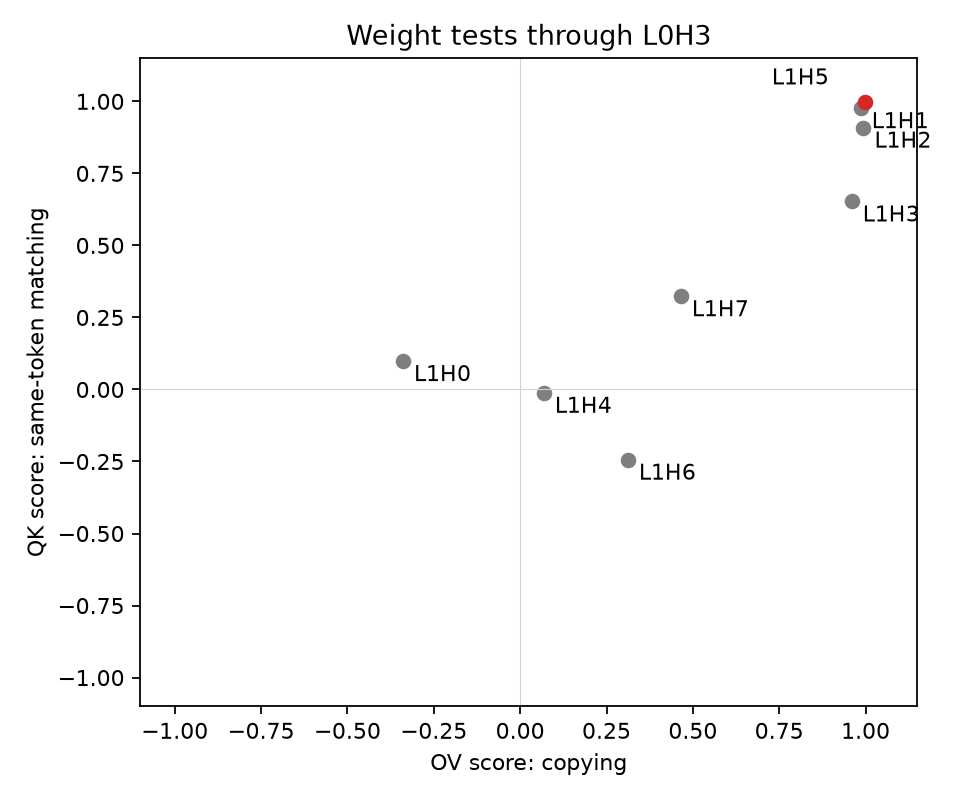

# Results: mechanistic analysis

No training or weight changes. Run on 2026-10-22.

## Attention

Heads selected on 32 discovery sequences:

- L0H3: previous-token head.
- L1H5: matching-source head.

On 32 separate evaluation sequences (128 queries), L1H5 puts **60.27%** of its attention on the earlier matching B positions. Its highest-attention position is a matching source in **71/128 queries (55.47%)**.

These measure source attention, not next-token prediction accuracy.

## Weight tests

Both maps use L0H3 as the early head.

| Late head | OV score | Composed QK score |
|---|---:|---:|
| L1H0 | -0.3395 | 0.0985 |
| L1H1 | 0.9857 | 0.9764 |
| L1H2 | 0.9937 | 0.9088 |
| L1H3 | 0.9596 | 0.6525 |
| L1H4 | 0.0682 | -0.0115 |
| L1H5 | 0.9989 | 0.9971 |
| L1H6 | 0.3117 | -0.2437 |
| L1H7 | 0.4650 | 0.3236 |

The attention-selected L1H5 has the highest score in both weight tests. Other heads also have high scores. The results support the proposed copying/matching circuit, but do not prove a unique or complete circuit.

The score is `real(sum(eigenvalues)) / sum(abs(eigenvalues))`. It is not prediction accuracy. The maps omit biases, positions and other paths, following the simplified analysis in [Elhage et al. (2021)](https://transformer-circuits.pub/2021/framework/index.html).

## Records

- [Short summary](results/mechanism-reference/summary.md).
- [Exact inputs](results/mechanism-reference/inputs.json).
- [Attention, weight scores and eigenvalues](results/mechanism-reference/results.json).
- [Settings and model revisions](results/mechanism-reference/protocol.json).

The generator no longer reserves tokens for input controls. This changes the sampled inputs. The weight scores are unchanged; attention was measured again on the new inputs. Earlier reference folders record older versions, not extra independent replications.

Eight tests passed, and the full script ran on the pinned pretrained model.
