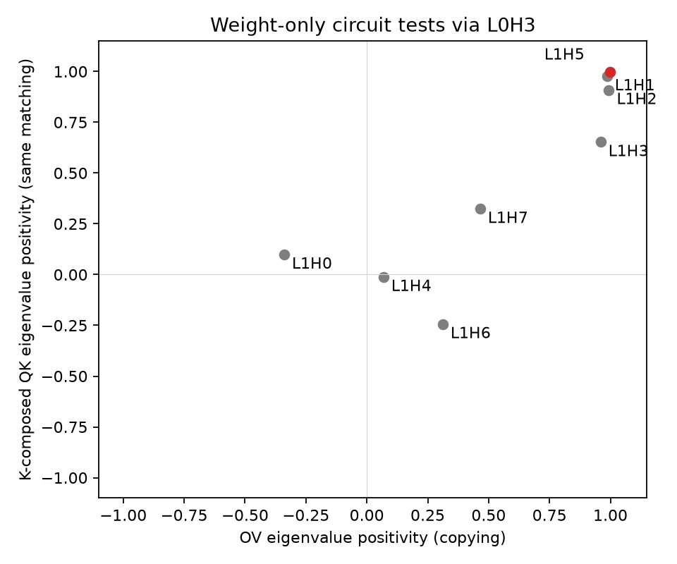

# Results: paper-style mechanistic tests

Recorded on 2026-10-22. No training or weight updates. The recurring-pair inputs and seeds are unchanged from the earlier reference; this is not an independent replication.

## Behavioral check

Discovery/evaluation use 32 different sequences each. Every sequence has four distinct pairs and four occurrences per pair. The 128 evaluation questions are the last occurrence of every pair. Background gaps vary from 1 to 9 tokens.

| Condition | Mean loss (natural logarithm) | Top-1 accuracy over the full vocabulary |
|---|---:|---:|
| First occurrence | 14.861 | 0.000% |
| Fourth occurrence | 6.142 | 21.875% |
| No pair history | 13.875 | 0.000% |
| Rotated values, new answers | 6.252 | 18.750% |
| Rotated values, old answers | 13.980 | 0.000% |

Heads selected on separate discovery data: L0H3 (previous token) and L1H5 (matching-source attention). On evaluation data L1H5 has matching attention mass 0.5886 and a matching-source attention argmax in 75/128 queries. These attention numbers are not next-token accuracy. The task is only partially solved.

## The mechanistic test follows the paper

Following **Checking the Mechanistic Theory** in [Elhage et al. (2021)](https://transformer-circuits.pub/2021/framework/index.html), we examine two weight-only token maps for every late-layer head: OV copying, and same-token QK matching through the earlier previous-token head. The pair inputs are our variant; the paper also illustrates a full random sequence repeated three times.

With TransformerLens row-vector weights and early head p / late head h:

```text
M_OV = E @ W_V[h] @ W_O[h] @ U
Q = E @ W_Q[h]
K = E @ W_V[p] @ W_O[p] @ W_K[h]
M_QK = Q @ K.T / attention_scale
```

For each map we compute `real(sum(eigenvalues)) / sum(abs(eigenvalues))`, the summary shown in the paper. The nonzero eigenvalues are computed using a 64-by-64 matrix rather than constructing a vocabulary-sized map. The score is not the fraction of positive eigenvalues and is not prediction accuracy.

| Late head | OV positivity: copying | K-composed QK positivity: same matching |
|---|---:|---:|
| L1H0 | -0.3395 | 0.0985 |
| L1H1 | 0.9857 | 0.9764 |
| L1H2 | 0.9937 | 0.9088 |
| L1H3 | 0.9596 | 0.6525 |
| L1H4 | 0.0682 | -0.0115 |
| L1H5 | 0.9989 | 0.9971 |
| L1H6 | 0.3117 | -0.2437 |
| L1H7 | 0.4650 | 0.3236 |



The attention-selected L1H5 has the highest score on both axes: approximately 0.9989 for OV and 0.9971 for composed QK. This supports the proposed copying and matching mechanism. Other heads, especially L1H1 and L1H2, also have high spectral scores; the weight tests do not uniquely identify the active head or prove its actual behavior on every input.

## Separate ablations

The previous behavioral ablation sweep is retained as a separate check. Loss increases were 7.177 for L1H5, 7.039 for L0H3 and 5.641 for L0H2. These causal interventions are not the spectral metric and do not reproduce the paper's separate higher-order-term ablation procedure.

## Scope and verification

The main mechanistic analysis is now just the two tests in `experiments/paper_circuits.py`. It does not reconstruct every activation contribution. Biases and positional components are excluded from these particular weight maps, following the paper's simplified analysis. Other Q-, K- and V-composition paths can still matter in the complete model.

Ten tests passed. They check the low-rank eigenvalue identity, including complex eigenvalues, the meaning of each token-map axis, data generation and the retained legacy analysis. Behavioral results, attention measurements, input controls and all 16 ablations exactly match the prior reference.

This is one model and one data seed, without a significance test. Positive spectral bias is supporting evidence, not a sufficient proof of copying or a complete circuit. The earlier detailed-activation results remain in `results/reference`; they are not the current main analysis.

## Complete records

- [Exact inputs](results/paper-reference/inputs.json).
- [English examples and predictions](results/paper-reference/examples.md).
- [Mechanistic scores and eigenvalues](results/paper-reference/mechanistic_analysis.json).
- [Behavior, controls and ablations](results/paper-reference/results.json).
- [Protocol](results/paper-reference/protocol.json).